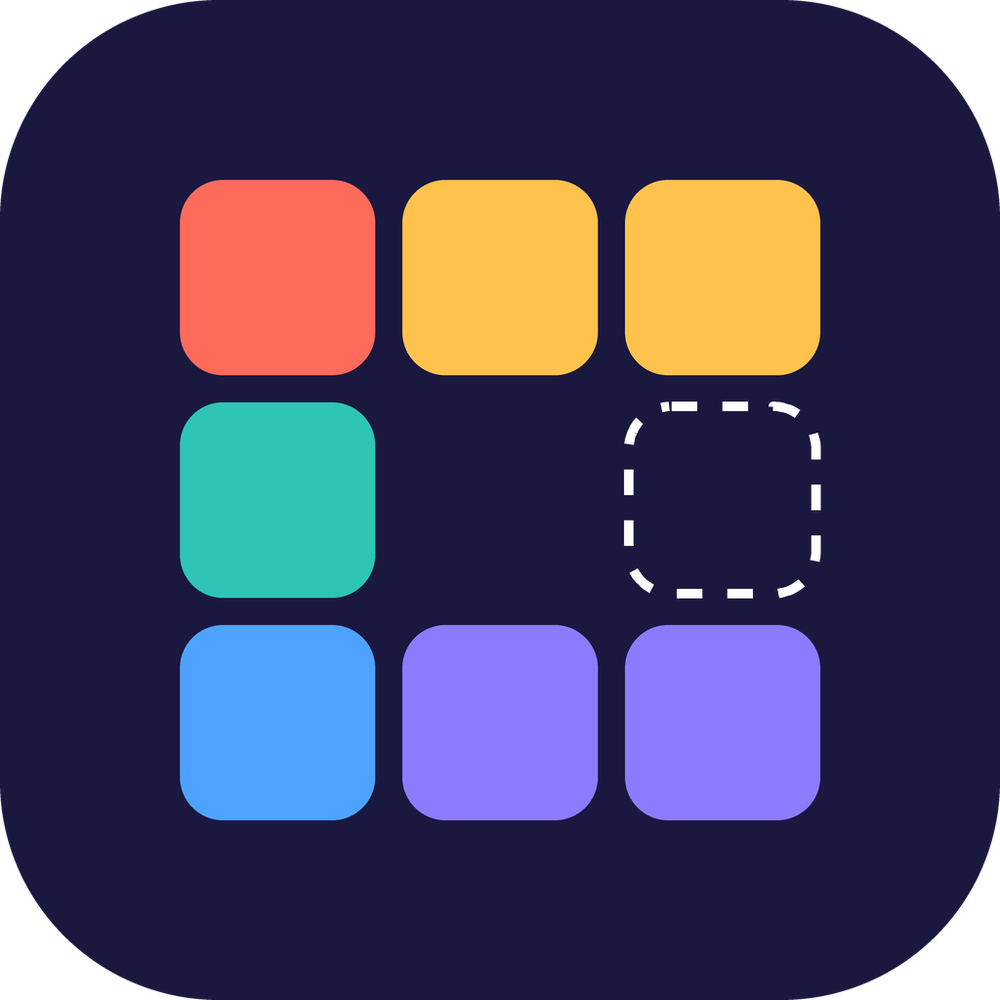
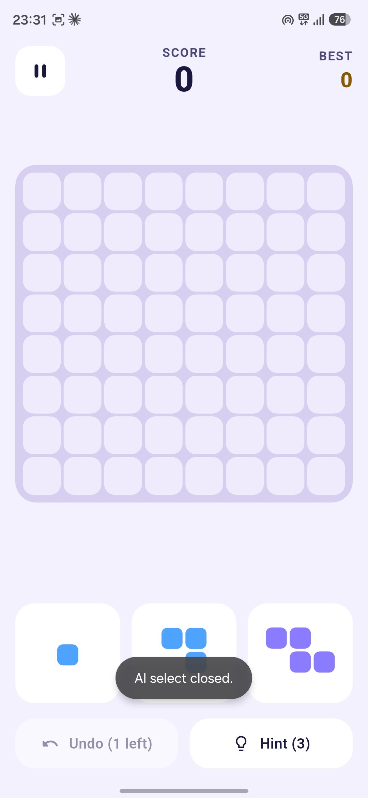
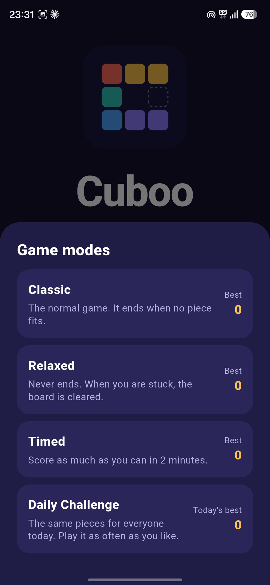
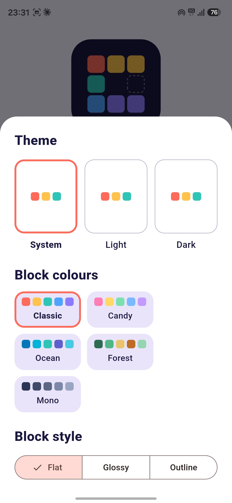
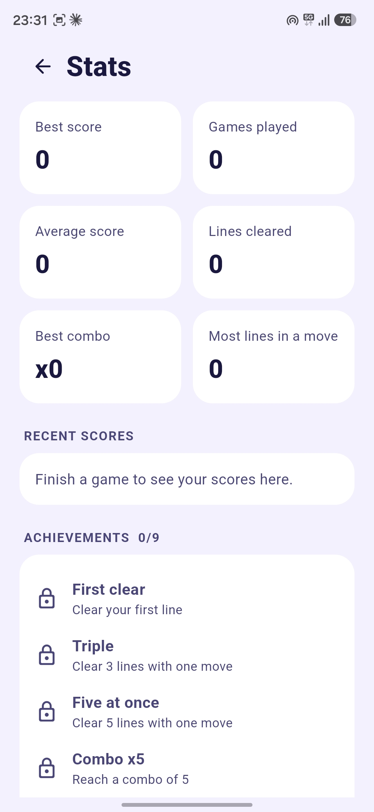

<div align="center">



# Cuboo

**A calm block puzzle for Android.**
Drag pieces onto the board, clear rows and columns, and keep your combo going.

[](https://github.com/lumio-apps/cuboo/releases/latest)
[](https://github.com/lumio-apps/cuboo/actions/workflows/ci.yml)
[](LICENSE)


**Fully offline · No ads · No tracking · Open source**

[**Download the latest APK**](https://github.com/lumio-apps/cuboo/releases/latest)

</div>

---

<div align="center">




</div>

## How to play

1. Three pieces wait at the bottom. **Drag** one onto the 8x8 board.
2. Fill a whole **row or column** to clear it.
3. Clear lines on **back-to-back moves** to build a combo and multiply your score.
4. When none of the pieces fit anymore, the game is over.
5. You get **one undo** and **three hints** per game.

### Scoring

| What | Points |
| --- | --- |
| Placing a piece | 1 point per block |
| Clearing lines | `lines x lines x 10 x combo` |
| Bomb | 5 points per block it destroys |

Clearing two lines at once is worth four times as much as one line, so aim for big clears.

## Features

**Game modes**

| Mode | What it is |
| --- | --- |
| **Classic** | The normal game. It ends when no piece fits. |
| **Relaxed** | Never ends. When you are stuck, the board is cleared. Tap a piece to turn it. |
| **Timed** | Score as much as you can in 2 minutes. |
| **Daily Challenge** | The same pieces for everyone today. Play it as often as you like. |

Every mode keeps its own best score.

**Gameplay**

- **Hints** show the move that clears the most lines
- **Bombs** show up now and then and blow up the 3x3 area around them
- **Undo** takes back your last move (once per game)
- **Left-handed mode** mirrors the top bar and the pieces

**Look and feel**

- Light, dark or system theme
- 5 block colour sets (Classic, Candy, Ocean, Forest, Mono)
- 3 block styles (Flat, Glossy, Outline)
- Smooth animations, sparks and a little screen shake on big clears. They switch off automatically when your phone asks to reduce motion.
- Short sound effects and vibration, each with its own switch

**Progress**

- **Stats**: best score, games played, average score, lines cleared, best combo
- **Recent scores**: your last 10 games
- **9 achievements** to unlock
- Your running game is saved, so you can leave and continue later

## Install

1. Open the [latest release](https://github.com/lumio-apps/cuboo/releases/latest) on your phone.
2. Download `Cuboo-vX.Y.Z.apk`.
3. Open the file. If Android asks, allow installing apps from this source.

After that, **Settings → Check for updates** finds new versions for you. Updates keep your scores, stats and settings.

## Privacy

- No ads, no analytics, no accounts, no trackers.
- Scores, stats, achievements, settings and the game in progress are stored **only on your phone**. They survive closing the app and updating it. They are removed only if you uninstall Cuboo or clear its data.
- The only network request is when you tap **Check for updates**: Cuboo asks the GitHub API for the newest release and, if you agree, downloads the APK from GitHub Releases. Nothing about you or your phone is sent.
- Sounds are bundled in the app. Nothing is downloaded while you play.

## Build from source

You need the [Flutter SDK](https://docs.flutter.dev/get-started/install) and an Android device or emulator.

```sh
git clone https://github.com/lumio-apps/cuboo.git
cd cuboo
flutter pub get
flutter run
```

Run the checks:

```sh
flutter analyze
flutter test
```

### Project layout

```
lib/
  game/        Game rules (pure Dart): shapes, board, scoring, undo, hints, modes
  screens/     Home, Game, Stats and Settings screens
  widgets/     Logo, board, pieces, buttons, game over card
  app_state.dart   Settings, scores, stats and achievements
  storage.dart     Everything saved on the phone (SharedPreferences)
  stats.dart       Stats and achievements
  sound.dart       Sound effects
  theme.dart       Colours, block palettes and block styles
  update_service.dart   The "Check for updates" feature
assets/
  icon/        App icon
  sounds/      Sound effects
test/          Unit and widget tests
```

The game rules in `lib/game/` have no Flutter dependency, so they are easy to test and reuse.

## Releases

Pushing a version tag such as `v1.0.0` starts the **Release** workflow. It builds the APK, signs it with the key stored in the repository secrets and publishes it on GitHub Releases. Pushes to `main` run the **CI** workflow (`flutter analyze` and `flutter test`).

Required repository secrets: `KEYSTORE_BASE64`, `KEYSTORE_PASSWORD`, `KEY_ALIAS`, `KEY_PASSWORD`.

## Contributing

Bug reports and ideas are welcome in [Issues](https://github.com/lumio-apps/cuboo/issues). Please keep the rules of the project in mind: **offline first, no ads, no tracking**.

## License

MIT, see [LICENSE](LICENSE).

---

<div align="center">

Made by [Lumio Apps](https://github.com/lumio-apps)

</div>
